

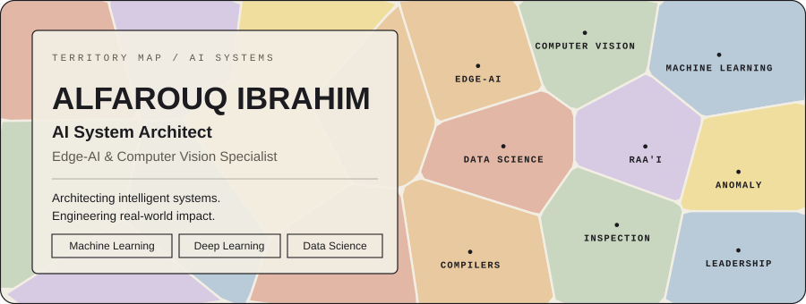

 


 

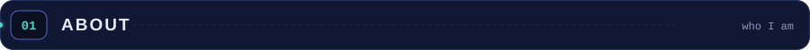

I design and build AI systems that work in real conditions. My focus is **Edge-AI**, **computer vision** and **machine-learning architecture**: models that run offline, on local hardware, where the data actually is.

I co-founded **Raa'i**, an award-winning offline livestock health-monitoring platform, founded the **ANOMALY** AI community (50+ members), and have worked across four ML internships and trainings in 2026.

 

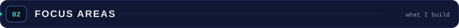

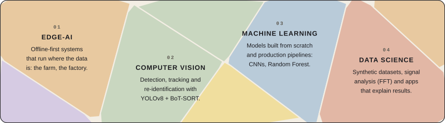

 

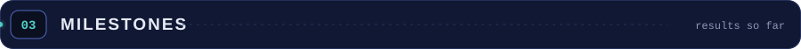

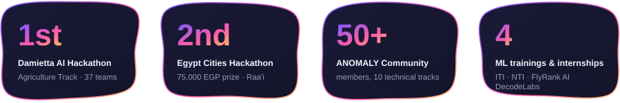

 

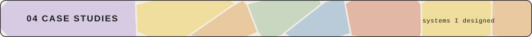

### Raa'i: offline Edge-AI livestock health monitoring

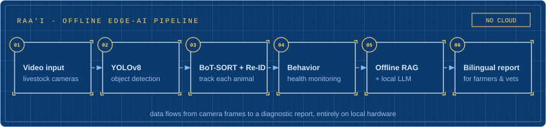

| | |
|---|---|
| **Role** | Co-Founder and Project Lead. I led the AI architecture design and implementation. |
| **Vision** | Multi-model computer-vision pipeline: YOLOv8 with BoT-SORT and Re-ID for real-time cattle behavior tracking. |
| **Reports** | Offline retrieval-augmented generation (RAG) pipeline with a local LLM that writes bilingual veterinary diagnostic reports for farmers and vets. |
| **Result** | 1st place, Damietta AI Hackathon, Agriculture Track (37 teams). 2nd place, Egypt Cities Hackathon, with a 75,000 EGP prize. |
| **Code** | Private repository. |

The pipeline reads left to right: camera frames, detection, per-animal tracking, behavior monitoring, report generation. All of it runs on local hardware with no cloud dependency.

 

### Multi-Modal Edge-AI Inspection System

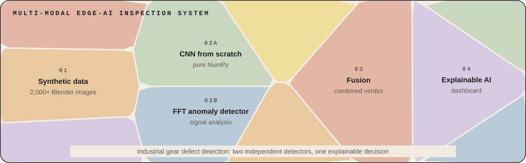

| | |
|---|---|
| **What** | Industrial gear defect detection with two independent detectors and one explainable decision. |
| **CNN** | A convolutional network written from scratch in pure NumPy, with no deep-learning framework. |
| **Signal** | An FFT-based anomaly detector working in the frequency domain. |
| **Fusion** | Both detectors feed an Explainable AI dashboard. |
| **Data** | A 2,000+ image synthetic dataset generated in Blender. |
| **Code** | [DecodeLabs-Project2-Inspection-System](https://github.com/alfarouq637/DecodeLabs-Project2-Inspection-System) |

 

### Language of the Quran: native compiler ecosystem

A compiler that translates Arabic linguistic roots and diacritics into memory semantics and emits native **x86-64 (PE64)** binaries directly. It is now entering its self-hosting phase. *In progress since March 2026.*

 

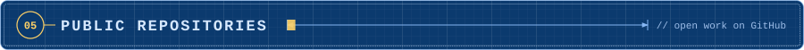

| Repository | What it is | Stack |
|---|---|---|
| [**DecodeLabs-Project2-Inspection-System**](https://github.com/alfarouq637/DecodeLabs-Project2-Inspection-System) | Multi-modal Edge-AI inspection system for industrial gear defect detection: NumPy CNN, FFT signal analysis, explainable AI. | Python, NumPy |
| [**Decentralized-Autonomous-Police-Fleet-DecodeLabs**](https://github.com/alfarouq637/Decentralized-Autonomous-Police-Fleet-DecodeLabs) | A decentralized blockchain architecture to secure cyber-physical systems and autonomous robot fleets. | Solidity |
| [**ITI-Graduation-Project-house-price-prediction**](https://github.com/alfarouq637/ITI-Graduation-Project-house-price-prediction) | End-to-end ML web app that predicts Indian house prices with a Random Forest pipeline. | FastAPI, React, TypeScript, scikit-learn |
| [**NTI_Graduation_Project**](https://github.com/alfarouq637/NTI_Graduation_Project) | Final project of the NTI internship. | Jupyter Notebook |
| [**ALFA-Kit**](https://github.com/alfarouq637/ALFA-Kit) | Advanced automation and OCR tool. | Python |
| [**Faculty-Attendance-Tracker**](https://github.com/alfarouq637/Faculty-Attendance-Tracker) | Faculty attendance tracking application. | TypeScript |
| [**muslim-app-release**](https://github.com/alfarouq637/muslim-app-release) | Free, ad-free Muslim app: adhkar, Quran, prayer times, adhan and notifications. | Release repo |

<b>More repositories</b>

 

- [codealpha_tasks](https://github.com/alfarouq637/codealpha_tasks): CodeAlpha Python programming internship tasks.
- [breast_cancer_dataset_streamlit_task](https://github.com/alfarouq637/breast_cancer_dataset_streamlit_task): Streamlit task for the NTI internship.
- [NTI_Iris_dataset_for_streamlit](https://github.com/alfarouq637/NTI_Iris_dataset_for_streamlit): Iris model deployed with Streamlit (NTI internship).
- [alfarouq637.github.io](https://github.com/alfarouq637/alfarouq637.github.io): personal site repository.
- [Batman-Register-page](https://github.com/alfarouq637/Batman-Register-page): HTML5 register page, built for fun.

 

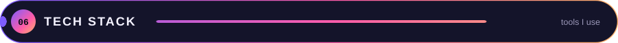

**Languages**&nbsp;

**Machine learning and vision**&nbsp;

**Apps and tooling**&nbsp;

 

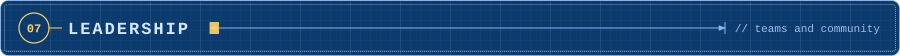

| Role | Organization | Since |
|---|---|---|
| Co-Founder and Project Lead | **Raa'i** | Jul 2026 |
| Founder and CEO, AI/Data Science Architect | **ANOMALY Community**: 50+ members across 10 technical tracks | May 2026 |
| Vice Head | **Google Developer Groups on Campus** | Aug 2026 |
| Machine Learning Trainee | **Information Technology Institute (ITI)**, Suez Canal Branch | Jul 2026 |
| Machine Learning Intern | **National Telecommunication Institute (NTI)**, remote | Jul 2026 |
| Machine Learning Intern | **FlyRank AI**, remote | Jun 2026 |
| Public Relations Volunteer | **Youth Leads Youth (YLY)**, Ministry of Youth and Sports | Jul 2026 |

**Certifications:** Build with AI: Masr Edition (Google, 2026) · Artificial Intelligence Ambassadors Program (MCIT Egypt, 2026) · Robotics and Automation Internship (DecodeLabs, 2026)

 

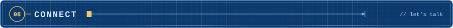

Open to **AI Architecture** and **Machine Learning Engineering** opportunities. The fastest way to reach me is LinkedIn or email.

